


**Jarima maydonchasi uchun to'liq avtomatlashtirilgan tizim:** kamera mashina raqamini taniydi, tizim saqlash haqini soatlab hisoblaydi, EPOS orqali chek chiqaradi va uch shart bajarilgandagina shlagbaumni ochadi.

---

## Darvoza qanday ishlaydi

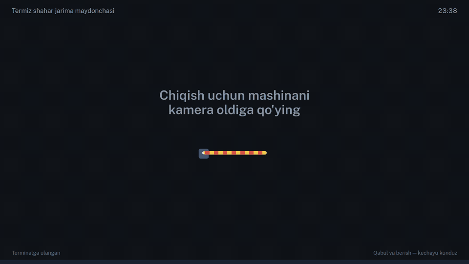

Darvoza oldida turgan haydovchi o'z ekranida 8 holatdan birini ko'radi. Shlagbaum faqat **uch shart** birga bajarilganda ochiladi:

1. **Haq to'langan** — EPOS fiskal chek chiqqan;
2. **Amaldagi ruxsatnoma bor** — operator IIV kabinetidan olingan raqamni kiritgan;
3. **Oluvchi aniqlangan** — mashinani kim olib ketayotgani yozilgan.

Bulardan biri yetishmasa, tizim shlagbaumni ochmaydi va sababini ekranda ko'rsatadi.

## Asosiy imkoniyatlar

| | |
|---|---|
| 📷 **ANPR kamera (FTP)** | Kamera raqamni o'zi taniydi va kadrni ichki FTP serverga yozadi. Tizim mashinani avtomatik ro'yxatga oladi |
| ⏱️ **Soatlik tarif** | VMQ 149-son qarori bo'yicha saqlash haqi **soatlab** hisoblanadi. Tarif hokimlik belgilagan chegaradan oshmaydi |
| 🧾 **EPOS fiskal chek** | Kassa EPOS orqali ulanadi. Pul butun so'mda (`int64`) saqlanadi, hech qayerda yaxlitlash xatosi yo'q |
| 🚧 **Shlagbaum (TCP rele)** | Darvozani kamera emas, tizim ochadi. Kamera whitelist'i o'chirilgan |
| 📱 **Hovli telefoni** | Android ilova QR orqali terminalga ulanadi, mashina suratlarini oladi va LAN'da internetsiz ishlaydi |
| 🏛️ **Nazorat paneli** | Prokuratura, soliq va hokimlik faqat ko'rish huquqi bilan kiradi. Rol va hudud **serverda** biriktiriladi, shaxsiy ma'lumot niqoblanadi |
| 🔐 **Litsenziya** | Ed25519 imzoli kalit, kompyuterning 3 ta barmoq izidan 2 tasi mos kelishi kerak. Kalitsiz dastur demo rejimda ishlaydi |
| 🧱 **O'chirilmaydigan jurnal** | Har amal audit jurnaliga yoziladi, SQLite trigger'lari yozuvni o'chirishga yo'l qo'ymaydi |

## Ekranlar

<table>
<tr>
<td width="50%">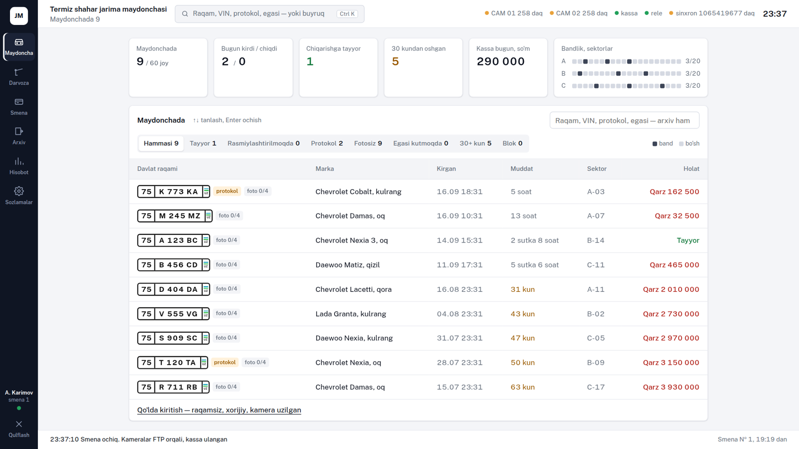 <b>Operator ish o'rni</b> — maydonchadagi mashinalar, sektorlar bandligi, qarz va muddat</td>
<td width="50%">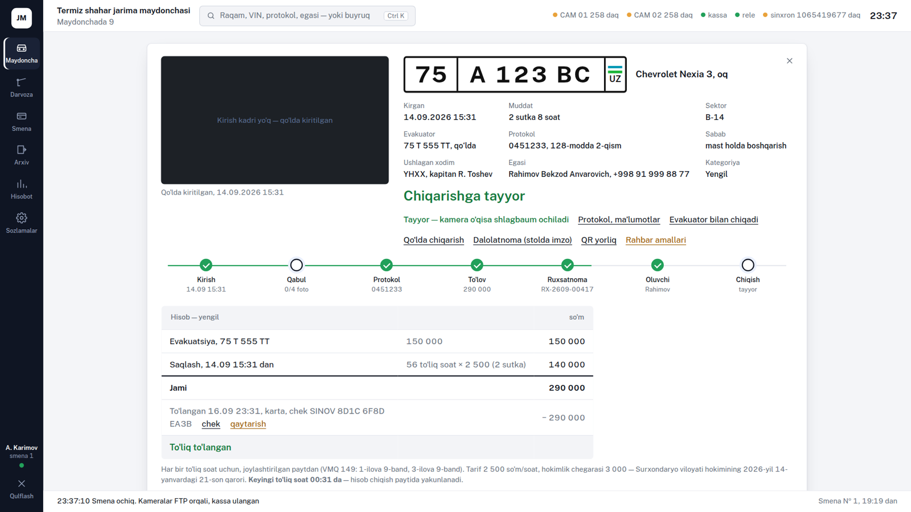 <b>Mashina kartochkasi</b> — uch shart holati, to'lov va chiqarish</td>
</tr>
<tr>
<td>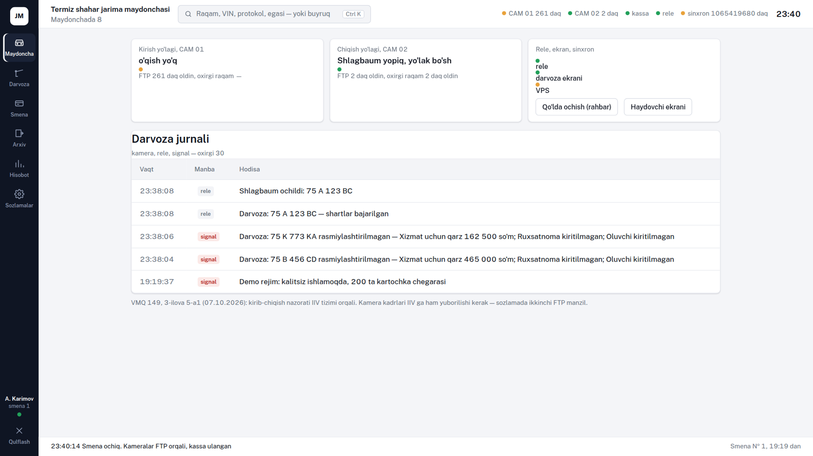 <b>Darvoza paneli</b> — kamera hodisalari va shlagbaum boshqaruvi</td>
<td>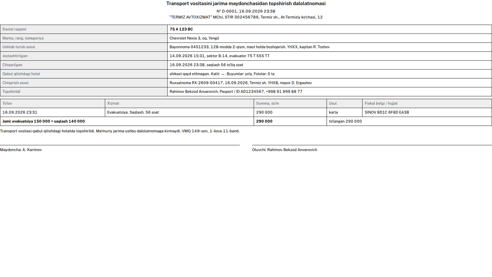 <b>Dalolatnoma</b> — mol-mulk ro'yxati bilan, chop etishga tayyor</td>
</tr>
<tr>
<td>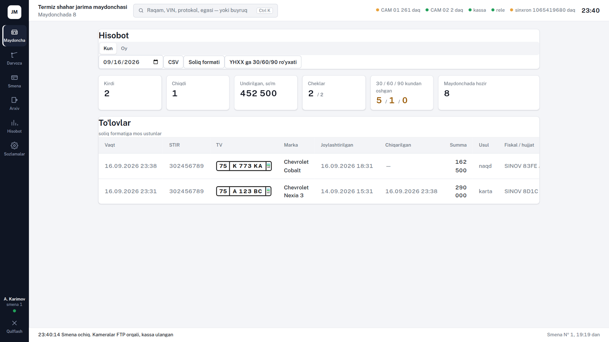 <b>Hisobot</b> — tushum, kirdi-chiqdi, uzoq turganlar</td>
<td>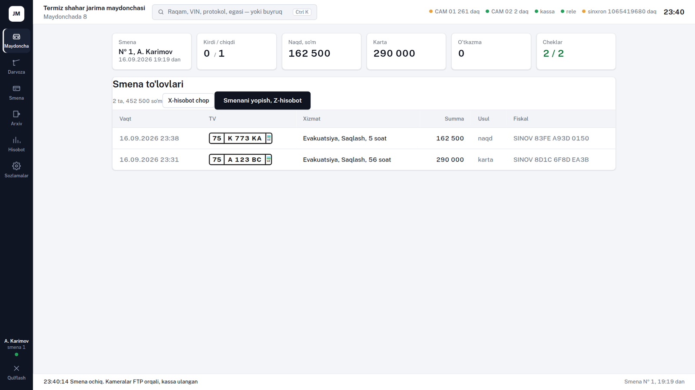 <b>Smena</b> — kassirning ochilish va yopilish hisobi</td>
</tr>
<tr>
<td>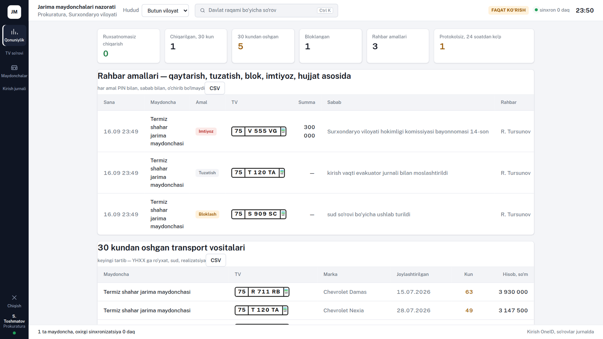 <b>Nazorat: prokuratura</b> — viloyat bo'yicha to'liq ko'rinish</td>
<td>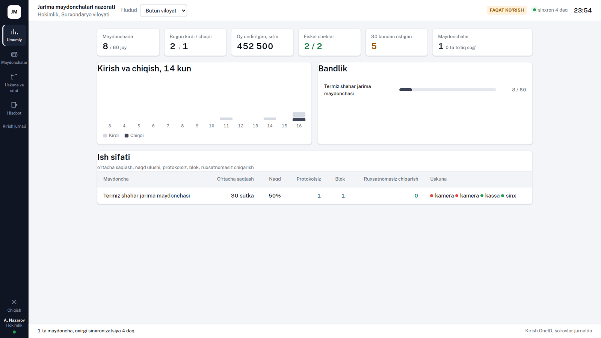 <b>Nazorat: hokimlik</b> — shaxsiy ma'lumotsiz statistika</td>
</tr>
</table>

> Suratlardagi barcha raqamlar, ismlar va tashkilotlar **namuna ma'lumot**.

## Arxitektura

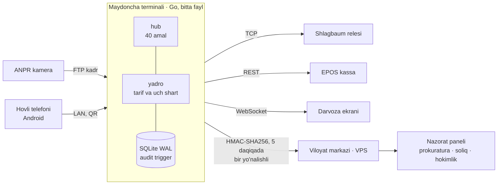

- **Terminal** maydonchada turadi va **internetsiz** ishlaydi. Front binar ichiga joylangan, natijada bitta 13 MB fayl chiqadi (Linux va Windows, cgo'siz).
- **Markaz** terminaldan faqat qabul qiladi va terminalga hech qachon buyruq bermaydi. Fotosurat markazga yuborilmaydi, faqat uning xeshi boradi.
- **Windows ilova:** WebView2 oynasi, tizim xizmati (avtomatik qayta ishga tushadi), tray ikonka, darvoza ekrani uchun kiosk rejimi.

## Sifat

- `go test ./...` — hisob yadrosi va litsenziya bo'yicha sinovlar.
- **Front–server mosligi sinovi:** 15 ta holatda front'dagi `store.js` Node'da ishga tushiriladi va natijasi Go hisobi bilan solishtiriladi. Sinovning o'zi ham tekshirilgan: front ataylab buzilganda sinov yiqiladi.
- To'liq zanjir uchidan uchigacha tekshirilgan: FTP kadr → ro'yxatga olish → to'lov → EPOS → ruxsatnoma → uch shart → shlagbaum → dalolatnoma.

## Huquqiy asos

- Vazirlar Mahkamasining 25.05.2011 dagi **149-son** qarori, 1-ilova: saqlash **soatlarda** hisoblanadi, ruxsatnoma «Jarima maydonchasi» axborot tizimi orqali beriladi.
- Tarif chegarasini viloyat hokimligi Moliya vazirligi bilan kelishgan holda belgilaydi. Dasturda o'z narxi (`hour`) hech qachon shiftdan (`capHour`) oshmaydi.

---

**Manba kodi yopiq.** Namoyish yoki hamkorlik bo'yicha: Telegram [@Humoyun_Davronov](https://t.me/Humoyun_Davronov)

Muallif — Humoyun Davronov

